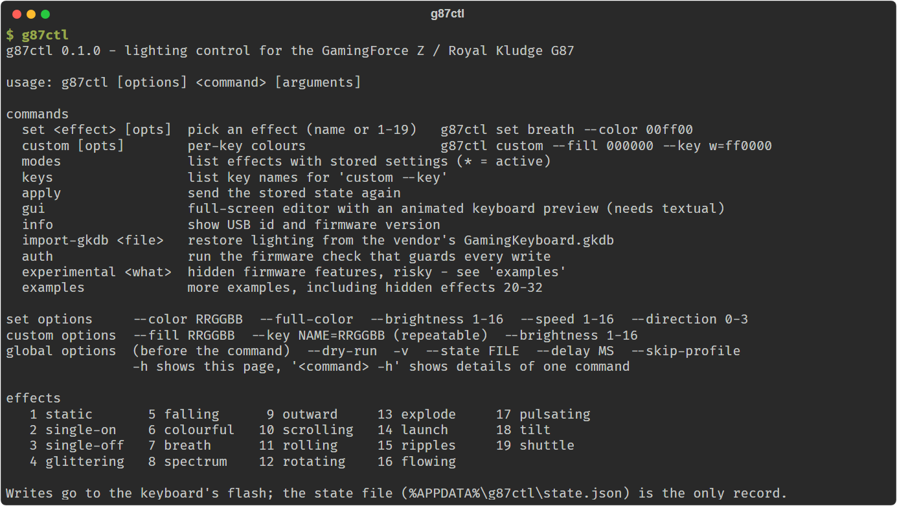
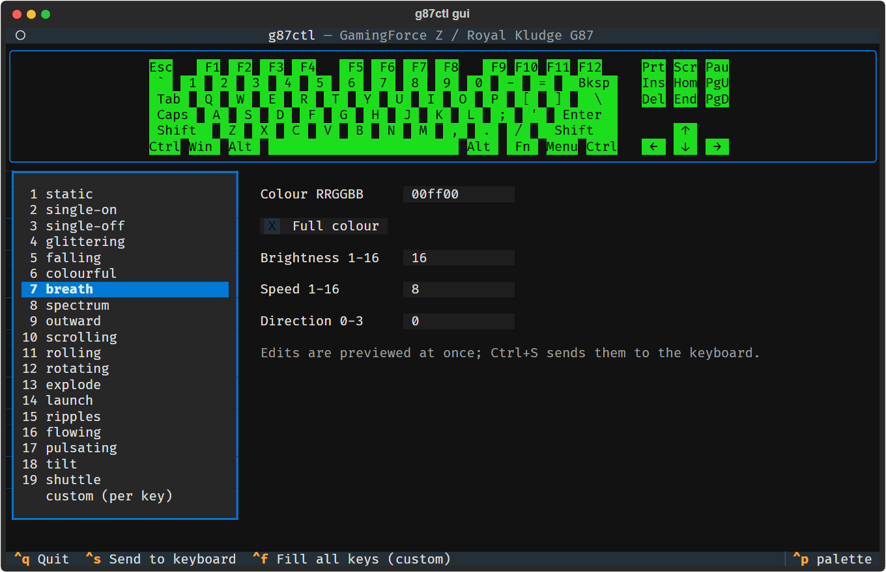
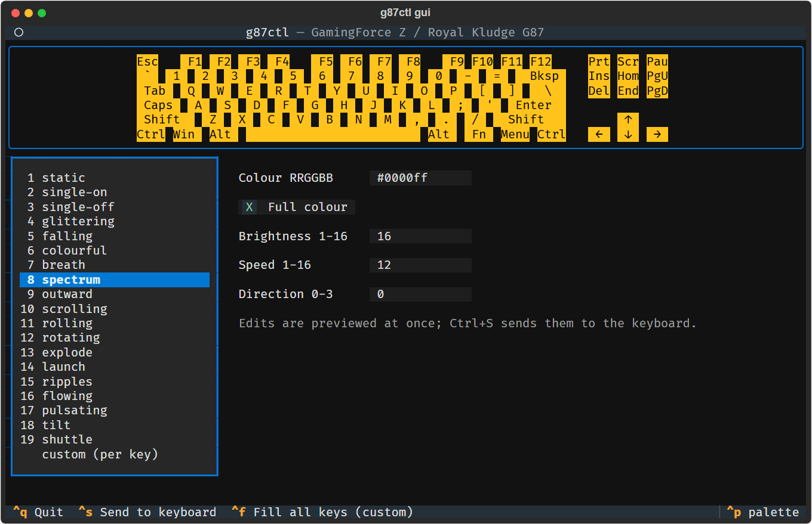
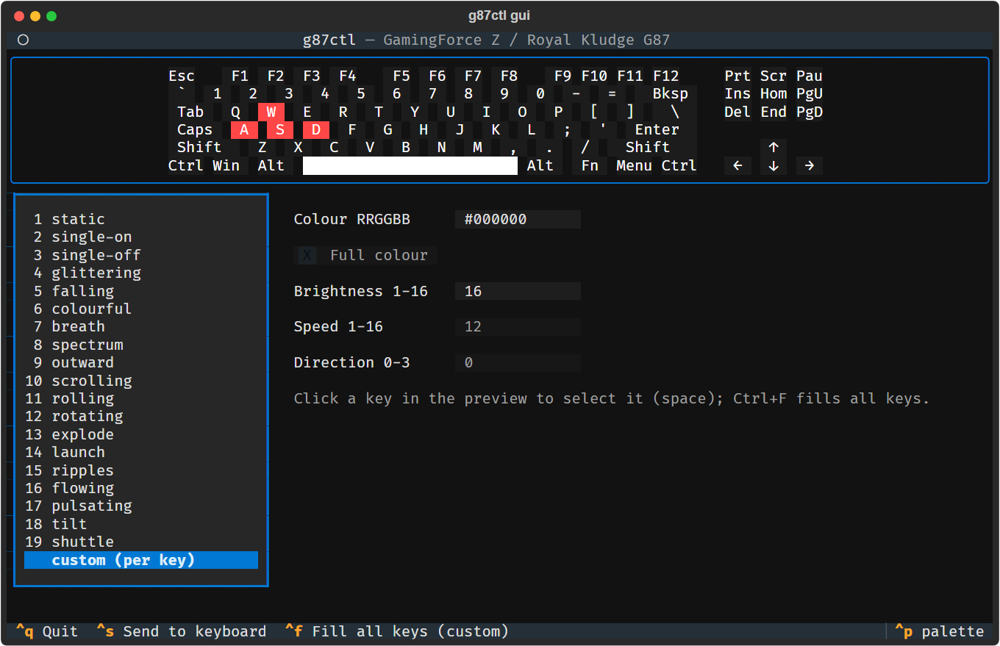

# g87ctl

Open source lighting control for the **GamingForce Z / Royal Kludge G87 RGB**
keyboard, whose vendor tool was abandoned, Windows only and misbehaves on
Windows 11. `g87ctl` is cross-platform: it is written in pure Python on top of
[hidapi](https://pypi.org/project/hidapi/) and should run on Windows, Linux and
macOS.

The protocol was reconstructed from the vendor tool and is documented in
[docs/PROTOCOL.md](docs/PROTOCOL.md).

## Status

| Feature | State |
|---|---|
| keyboard detection, device information | works |
| firmware authenticity check (`04 AB`) | works |
| 19 built-in effects: colour, brightness, speed, direction | works |
| per-key colours | implemented, key positions need confirmation |
| import from the vendor tool's database (`.gkdb`) | works |
| undocumented commands and hidden effect numbers | available under `experimental` |
| key remapping, macros, gaming mode | documented only |
| GUI | planned |

Tested on Windows 11 with firmware 1.01, USB `05AC:024F`. Linux and macOS are
supported by design (nothing in the code is Windows specific) but not tested
yet - reports are welcome.

## Safety

- The USB id `05AC:024F` is reported by many **other** SONiX based keyboards.
  `g87ctl` therefore runs the firmware authenticity check before every write
  and refuses to write if the keyboard fails it.
- Writes go to the keyboard's flash memory. The tool writes only the lighting
  block and the 64 byte profile block; it never touches the key map or macros.
- The keyboard cannot report its stored settings, so the tool keeps a copy in a
  state file (`%APPDATA%\g87ctl\state.json` or `~/.config/g87ctl/state.json`)
  and always sends the complete set.
- Use at your own risk.

## Installation

Python 3.10 or newer is required.

```
pip install .
```

or, without installing the package:

```
python -m pip install hidapi
python -m g87ctl
```

### Linux

Access to the `hidraw` node needs a udev rule, otherwise the tool must run as
root. Create `/etc/udev/rules.d/99-g87ctl.rules`:

```
KERNEL=="hidraw*", ATTRS{idVendor}=="05ac", ATTRS{idProduct}=="024f", TAG+="uaccess"
```

then run `sudo udevadm control --reload-rules && sudo udevadm trigger` and
replug the keyboard.

### macOS

macOS may ask to grant the terminal "Input Monitoring" permission
(System Settings > Privacy & Security) before the keyboard can be opened.

## Usage

Running `g87ctl` without arguments prints a one screen overview of every
command, option and effect.



```
g87ctl info                               # device information
g87ctl modes                              # effects and their stored settings
g87ctl set static --color ff0000          # solid red
g87ctl set breath --color 00ff00 --speed 8
g87ctl set spectrum --full-color --brightness 10
g87ctl set scrolling --direction 1
g87ctl custom --fill 000000 --key w=ff0000 --key a=ff0000 --key s=ff0000 --key d=ff0000
g87ctl keys                               # key names for --key
g87ctl apply                              # send the stored state again
g87ctl import-gkdb GamingKeyboard.gkdb    # restore settings from the vendor database
```

### Terminal UI

```
pip install .[gui]
g87ctl gui
```

Opens a full-screen editor built on [Textual](https://textual.textualize.io/).
The top shows an animated preview of the keyboard, below it the list of effects
and their settings. Edits show up in the preview immediately and are sent to
the keyboard with `Ctrl+S`. In the `custom` mode click a key in the preview to
select it and type its colour; `Ctrl+F` fills every key with the colour in the
field. `--dry-run` and `--state` work as in the command line.







The animations are only a rough approximation of the effects: the firmware
does not document them, and the preview layout is a guess at an ANSI TKL board.

Global options go before the command: `--dry-run` prints the data instead of
sending it, `-v` logs every HID packet, `--state FILE` selects another state
file.

Ranges: brightness and speed 1-16, direction 0-3, colours as `RRGGBB`.

### Experimental commands

The vendor tool contains commands whose effect is not known, and the firmware
may have more effects than the tool exposes. They can be tried with:

```
g87ctl experimental ping            # 04 E0, harmless
g87ctl experimental cmd18           # 04 18
g87ctl experimental cmd19           # 04 19
g87ctl experimental cmdf0           # 04 F0
g87ctl experimental cmdf1           # 04 F1
g87ctl experimental effect 20       # hidden effect numbers 20-32, accepts --color etc.
g87ctl experimental raw 12          # any 04 xx opcode
```

Each of them prints a warning and asks for confirmation (`--yes` skips the
prompt). `raw` is the dangerous one: an unknown opcode may erase part of the
flash before any data arrives, and the key map and macros can only be restored
with the vendor tool. `effect` does not change the state file, so
`g87ctl apply` brings the previous lighting back. If you learn what any of
these do, please report it so the protocol document can be completed.

## Development

```
pip install -e .[dev]
pytest
```

The vendor tool's files are not part of this repository; they belong to the
manufacturer.

## License

MIT
